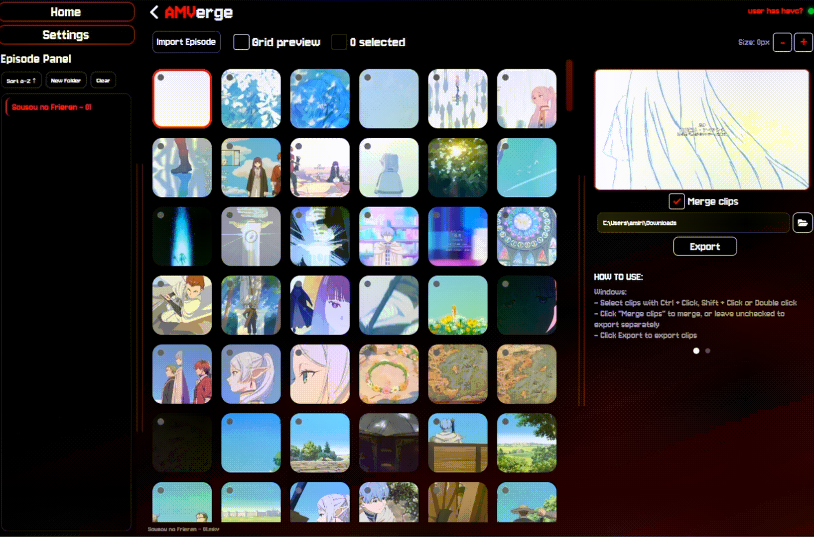
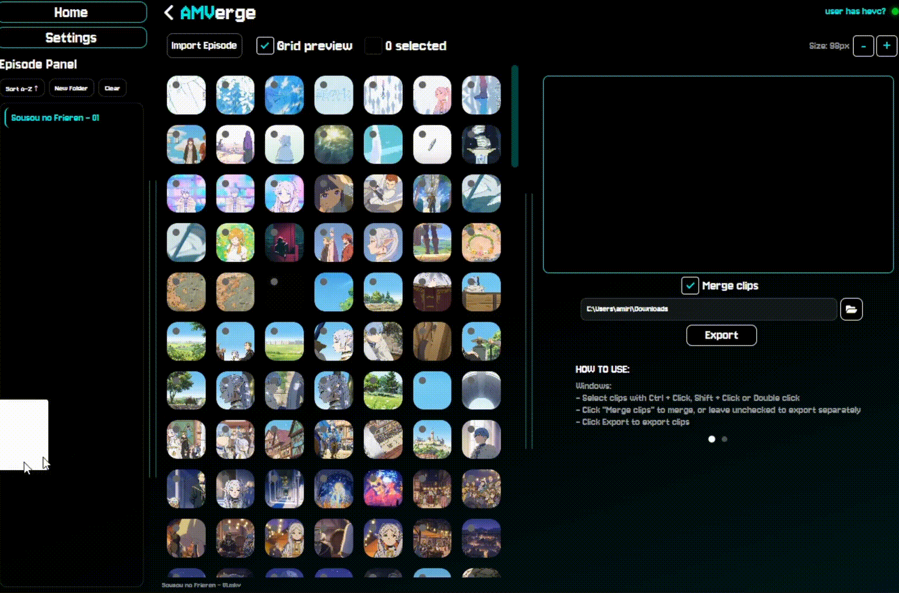

<p align="center">
  
</p>

# AMVerge

**Fast desktop scene-splitting, semantic scene search, and clip-export software for editors.**  
AMVerge helps editors turn long videos into usable clips quickly. Import an episode, split it into scenes, preview and organize results in folders or scenepacks, search across footage with Scene Scout, and export or send clips straight into your editor.

---

## Features

- **Flexible scene splitting** — keyframe-based cutting, GPU-accelerated AI scene detection (`TransNetV2`), and CPU detection (`PySceneDetect`)
- **Instant clip previewing** — lazy-mounted streaming video clips and animated WebP grid previews
- **Scene Scout** — SigLIP 2 semantic text search and visual Flow / Match similarity search across indexed `.scoutdb` databases
- **Scenepacks & folder organization** — organize imported episodes into nested folders and build reusable scenepacks
- **Tools & post-export passes** — standalone and post-export AI depth-map and upscaling passes
- **Fast & flexible exports** — batch clip export, merged exports, exact-copy remuxing, and GPU-accelerated encoding (NVENC, AMF, QSV, VideoToolbox, VAAPI)
- **Direct editor integration** — send selected clips directly into After Effects, Premiere Pro, DaVinci Resolve, or CapCut
- **HEVC & proxy workflows** — automatic codec detection and on-demand H.264 proxy previews for webview playback
- **Customizable UI & community features** — resizable panels, custom themes/backgrounds, Events browser, and Discord Rich Presence / sign-in

<p align="center">
  
  
  
  
</p>

---

## How It Works

```txt
Frontend (React + TypeScript)
          ↓
Desktop Layer (Tauri + Rust)
          ↓
AMVerge-CLI (Python sidecar)
          ↓
FFmpeg / FFprobe / PyAV
```

### Frontend (`frontend/src/`)

Handles:

- importing videos and drag-and-drop workflows
- virtualized clip grids and preview playback
- Scene Scout search, Flow matching, Scenepacks, Tools, and Events
- selection, merging, and export configuration
- sidebar episode/folder organization and UI customization

### Tauri Layer (`frontend/src-tauri/`)

Handles:

- desktop packaging and auto-updates
- command bridge, event streaming, and Job-Object child-process management
- filesystem access, storage relocation, and IndexedDB/settings persistence
- FFmpeg/FFprobe proxy/WebP generation and editor automation

### Backend (`AMVerge-CLI`)

Video processing lives in a companion repository, [AMVerge-CLI](https://github.com/AMVerge-team/AMVerge-CLI) (run from a local virtualenv in dev and bundled as a PyInstaller sidecar in releases). It handles:

- keyframe, `TransNetV2`, and `PySceneDetect` scene detection
- clip cutting, exact-copy remuxing, and hardware-accelerated export pipelines
- Scene Scout SigLIP 2 embedding, indexing, and daemon search
- AI depth-map and upscaling passes

---

## Scene Splitting Options

AMVerge supports both stream-copied keyframe splitting and AI/CPU cut detection:

- **Keyframe Detection** — splits cleanly at source keyframes with zero re-encoding on import
- **AI Scene Detection (`TransNetV2`)** — detects visual cuts on GPU, stream-copying scenes aligned to closed keyframes and queueing background cuts for the rest
- **CPU Detection (`PySceneDetect`)** — adaptive scene detection without requiring GPU weights

---

## Repository Structure

```txt
AMVerge/
├── setup.ps1                  # Windows dev setup (clones & links AMVerge-CLI)
├── setup.sh                   # macOS / Linux dev setup
├── frontend/
│   ├── src/
│   │   ├── App.tsx
│   │   ├── components/        # clipsGrid, previewPanel, sidebar, sceneScout, tools, settings
│   │   ├── features/          # import, export, sceneScout, migration, tools, storage
│   │   ├── hooks/
│   │   ├── pages/             # HomePage, SceneScoutPage, ScenepacksPage, EventsPage, Menu, Settings
│   │   ├── stores/            # Zustand persisted & runtime stores
│   │   ├── styles/
│   │   ├── types/
│   │   └── utils/
│   ├── src-tauri/             # Rust Tauri backend (commands/, utils/, config)
│   ├── scripts/               # sidecar build & uv staging scripts
│   └── package.json
├── updates/                   # Release changelogs
├── CONTRIBUTING.md
├── documentation.md
├── RELEASING.md
├── LICENSE
└── README.md
```

---

## Getting Started

### Requirements

- [Git](https://git-scm.com)
- [Node.js](https://nodejs.org) 20+
- [Python](https://www.python.org/downloads/) 3.11+
- [Rust](https://rustup.rs) (stable)

See [CONTRIBUTING.md](CONTRIBUTING.md#local-setup) for platform-specific extras (WebView2 on Windows, Xcode CLI tools on macOS, Tauri GTK/WebKit libs on Linux) and `.env` / manual setup steps.

### One-Step Dev Setup

From the repo root (clones sibling `../AMVerge-CLI`, sets up its `.venv`, configures `.env`, and installs frontend dependencies):

```powershell
.\setup.ps1        # Windows
```

```bash
./setup.sh         # macOS / Linux
```

To also install the AI extras (TransNetV2, Scene Scout, depth, upscale) into the dev CLI virtualenv:

```powershell
.\setup.ps1 -Ai    # Windows
```

```bash
./setup.sh --ai    # macOS / Linux
```

### Run in Development

```bash
cd frontend
npm run tauri:dev
```

### Build Desktop App

```bash
cd frontend
npm run tauri:build
```

To stage the standalone Python sidecar manually:

```bash
cd frontend
npm run build:sidecar
```

For full architecture notes and release instructions, see [documentation.md](documentation.md) and [RELEASING.md](RELEASING.md).

---

## License

AMVerge is licensed under the GNU GPL v3.0 — see [LICENSE](LICENSE).

Any derivative work must also be open-source under the same license.
